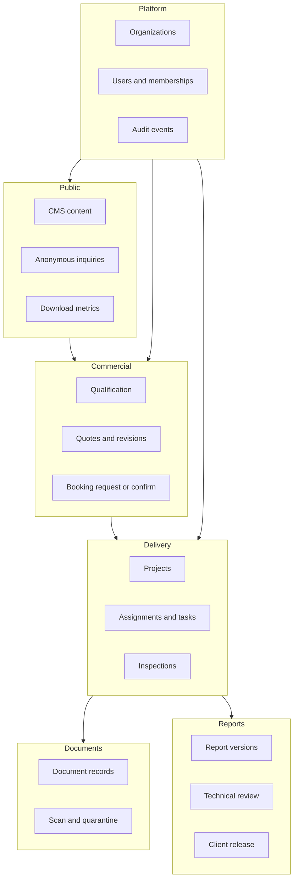
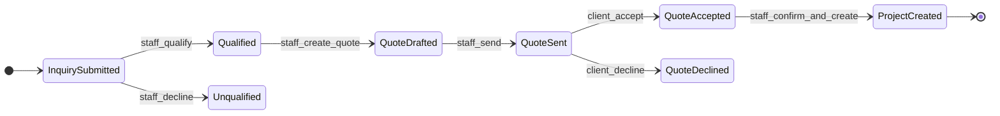
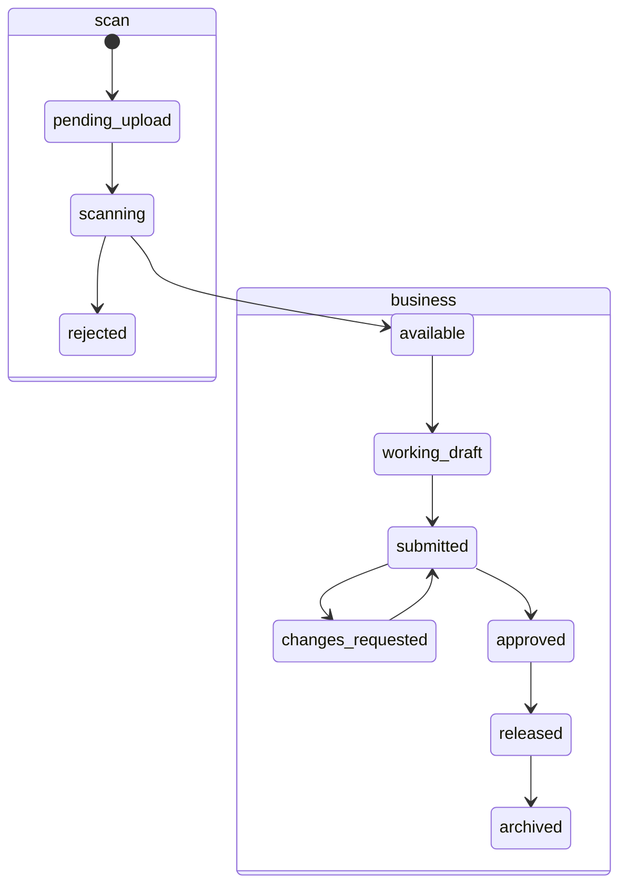
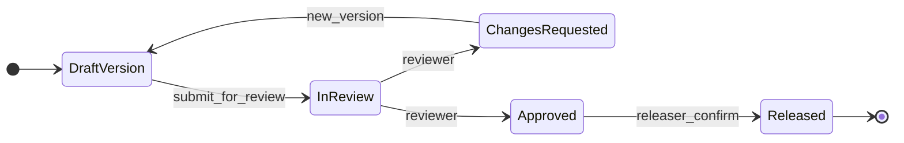

# P2.1 — Domain Architecture (ANT Marine W.A.)

**Phase:** 2 — Architecture (design only)  
**Status:** Awaiting stakeholder review  
**Prepared:** 22 November 2026  
**Repository:** `/Users/josephelormsegbefia/Desktop/elorm/appsentrix/ant_marine` (canonical Rails app; `~/Desktop/ant_marine` is a naming alias only — no separate clone verified on disk)

**Related documents:**

- [`P2_1_DOMAIN_RELATIONSHIPS.md`](P2_1_DOMAIN_RELATIONSHIPS.md) — ERD-style relationships and tenancy
- [`P2_1_OPEN_DECISIONS.md`](P2_1_OPEN_DECISIONS.md) — proposals and unresolved items
- [`../ANT_MARINE_MASTER_SPEC.md`](../ANT_MARINE_MASTER_SPEC.md) — product requirements
- [`../../design/PHASE_1_DESIGN_HANDOFF.md`](../../design/PHASE_1_DESIGN_HANDOFF.md) — screen journeys

**P2.1 scope:** No Active Record models, migrations, authentication, or UI. This document defines aggregates, lifecycles, and Rails conventions for P2.2 onward.

---

## 1. Design principles

Aligned with master spec §3.2:

| Principle | Application |
|---|---|
| UTC in persistence | All `datetime` columns; display in Ghana time and optional client zone in views |
| Reference numbers | Server-generated, unique, human-readable (e.g. `INQ-2026-00042`) on inquiries, quotes, projects |
| Status vs history | `current_status` on aggregates; every transition also recorded in `AuditEvent` (actor, from, to, reason) |
| Idempotent transitions | Quote acceptance, project creation, report release use guards + unique constraints to survive retries |
| Immutable versions | `QuoteRevision`, `DocumentVersion`, `ReportVersion` are append-only; business state points at specific version IDs |
| Release ≠ approve | Technical approval on a `ReportVersion`; client visibility only via `ReportRelease` to that exact version |
| Soft archive | Prefer `archived_at` / status over hard delete for client projects and retained documents |
| Organization boundary | Client company is the security tenant for client-visible data |
| Blob ≠ record | Active Storage holds bytes; `Document` / `Report` hold business metadata, permissions, and version chain |

---

## 2. Bounded contexts (one Rails monolith)

Logical modules share PostgreSQL and domain models; controllers and policies are namespaced by surface.

| Context | Responsibility | Primary screen groups |
|---|---|---|
| **Public** | Marketing site, service catalogue, articles, case studies, training listings, anonymous quote/visit forms, public resource downloads | P01–P24 |
| **Commercial** | Inquiry intake, staff qualification, quotations, booking preference vs confirmation, quote acceptance, project initiation | P19–P22, P23, S01–S06, C02–C04 |
| **Delivery** | Project execution, staff assignment, tasks, inspections, checklists, internal notes | C05–C08, S07–S11 |
| **Documents** | Client/staff uploads, requested files, versioning, scan workflow, previews | C07–C09, S10, M09 |
| **Reports** | Report drafting, review, approval, separate release to client | C11–C12, S12–S14 |
| **Billing** | Invoices and payment records (not live PSP unless approved) | C14, S15, M08 |
| **Collaboration** | Project-scoped messaging, user notifications | C10, S13 |
| **Administration** | CMS publish workflow, users/invitations, document rules, company settings, analytics | M01–M14 |
| **Platform** | Users, organizations, memberships, audit, reference numbering | A01–A06, M14 |

---

## 3. Organization model

### 3.1 Two organization kinds

| Kind | Purpose |
|---|---|
| `ant_marine` | Singleton (or single operational) internal organization; all staff memberships attach here |
| `client` | Each corporate client company; owns projects, vessels, client-visible documents and bills |

ANT Marine is **not** a client tenant. Staff act on client data through **role + assignment**, never by sharing one table row across client orgs.

### 3.2 Onboarding paths

1. **Anonymous inquiry** — `ServiceInquiry` with embedded contact snapshot; no `organization_id` until qualification.
2. **Qualified client** — staff create or link `Organization` (client) and optional `ClientContact` records.
3. **Invitation** — after approved engagement, `Membership` + invitation token (A02–A03); user joins one client org.
4. **Multi-membership** — rare; user chooses workspace (A06); session stores `current_organization_id`; every query scoped.

Public visitors never require an account to submit P19–P22 or P23.

---

## 4. Entity inventory

### 4.1 Classification legend

- **AR** — Aggregate root (consistency boundary)
- **ENT** — Entity inside aggregate
- **VO** — Value object / embedded attributes
- **EVT** — Event or projection (may be table or derived)

Not every product noun is its own table; consolidations below are intentional.

### 4.2 Platform & identity

| Name | Class | Purpose |
|---|---|---|
| `Organization` | AR | Tenant; `kind`, legal/display name, settings JSON for client-visible profile |
| `User` | AR | Login identity (auth deferred to P3) |
| `Membership` | AR | `user_id`, `organization_id`, `role`, status; unique active pair |
| `Invitation` | ENT | Pending membership; token, expiry, inviter |
| `AuditEvent` | EVT | Polymorphic `auditable`, actor, action, metadata, occurred_at |

**Roles:** See [`ROLE_PERMISSION_SPEC.md`](ROLE_PERMISSION_SPEC.md) and [`DEFAULT_ROLE_MATRIX.md`](DEFAULT_ROLE_MATRIX.md). Staff and client role keys are domain-separated; permissions resolved per hierarchy in ROLE_PERMISSION_SPEC.

### 4.3 Public & catalogue

| Name | Class | Purpose |
|---|---|---|
| `Service` | AR | Catalogue entry; slug, summary, detail copy, SEO fields, publish state |
| `ContentPage` | AR | Generic CMS page (about, contact blocks) — optional STI subtypes |
| `Article` | AR | Insights / news (P13–P14) |
| `CaseStudy` | AR | Approved project story (P10–P11, M05) |
| `TrainingOffering` | AR | Course/session listings (P16–P17, M06) |
| `PublicResource` | AR | Downloadable public file metadata (P15); not client confidential files |
| `ResourceDownload` | EVT | Anonymous download metric for analytics (M12) |
| `ContactMessage` | AR | P18 general contact (may merge into `ServiceInquiry` with `channel` — see open decisions) |

### 4.4 Commercial funnel

| Name | Class | Purpose |
|---|---|---|
| `ServiceInquiry` | AR | Public or logged-in request; service, location, need, preferred date VO, reference number |
| `InquiryContact` | VO/ENT | Name, email, phone, company name at submission time |
| `InquiryAttachment` | ENT | Pre-org uploads linked to inquiry (promoted to `Document` on project later) |
| `QualificationRecord` | ENT | Staff decision: qualified / unqualified / needs_clarification + notes |
| `Quote` | AR | Parent commercial offer; `client_organization_id`, originating `service_inquiry_id` |
| `QuoteRevision` | ENT | Immutable revision: scope, fee, currency, validity, exclusions; version number |
| `QuoteResponse` | ENT | Client accept/decline on a specific revision; consent captured |
| `BookingRequest` | AR | P23 preferred visit date; may link inquiry or stand-alone |
| `BookingConfirmation` | ENT | Staff-confirmed appointment; distinct from request |

**Funnel rule:** `Project` creation requires accepted `QuoteRevision` + staff confirmation guard (idempotent job).

### 4.5 Delivery

| Name | Class | Purpose |
|---|---|---|
| `Project` | AR | Client job; org, service, quote_revision_id, client-visible status label, internal status |
| `Assignment` | ENT | Staff user on project with `assignment_kind` (`lead_surveyor`, `surveyor`, `coordinator`, `technical_reviewer`, `collaborator`) — gates `projects.view_assigned` per ROLE_PERMISSION_SPEC §5 |
| `Task` | ENT | Deadlines, checklist linkage, assignee |
| `Vessel` | AR | Client-owned asset; org-scoped |
| `ProjectVessel` | ENT | Join: many vessels per project |
| `Inspection` | AR | Site work unit; date, location, type |
| `InspectionChecklist` | ENT | Template instance + item responses (S08–S09) |
| `InspectionFinding` | ENT | Structured finding rows |

### 4.6 Documents (generic files)

| Name | Class | Purpose |
|---|---|---|
| `Document` | AR | Business file record; category, classification, project/org scope |
| `DocumentVersion` | ENT | Immutable version; checksum, uploader, Active Storage blob reference |
| `DocumentAccessGrant` | ENT | Optional explicit file/project grant beyond role defaults (reviewers, collaborators) |
| `UploadRequest` | ENT | Staff request for client upload (C07): type, reason, due date |

**Scan workflow (logical states):** `pending_upload` → `scanning` → `available` | `rejected`  
**Business workflow:** `working_draft` → `submitted` → `changes_requested` → `approved` → `released` → `archived` (not all categories use every state)

### 4.7 Reports (deliverable subtype)

Reports reuse document patterns but add review/release aggregates.

| Name | Class | Purpose |
|---|---|---|
| `Report` | AR | Deliverable on a project; template reference optional |
| `ReportVersion` | ENT | Immutable draft/file versions |
| `ReportReview` | ENT | Reviewer decision per version; request_changes / approved |
| `ReportRelease` | ENT | Client release of **one approved** `report_version_id`; recipient audit |

Client portal lists reports only when a `ReportRelease` exists for their organization (C11–C12).

### 4.8 Billing & collaboration

| Name | Class | Purpose |
|---|---|---|
| `Invoice` | AR | Bill to client org; project link; line items as ENT or JSON |
| `PaymentRecord` | ENT | Amount, method, recorded_by; not live card capture unless approved |
| `Conversation` | AR | Project-scoped thread |
| `Message` | ENT | Author, body, timestamps |
| `Notification` | ENT | User inbox; type, read_at, link to resource |

**Notification vs audit:** `AuditEvent` is authoritative compliance history; `Notification` is UX delivery (can be rebuilt from audit with care).

### 4.9 Administration configuration

| Name | Class | Purpose |
|---|---|---|
| `DocumentRule` | AR | Category defaults: retention, who may view/upload, size/type (M09) |
| `CompanyProfile` | VO | M11 settings; may live on `Organization` for `ant_marine` kind |

---

## 5. Core entity specifications (summary)

Detailed cardinalities live in [`P2_1_DOMAIN_RELATIONSHIPS.md`](P2_1_DOMAIN_RELATIONSHIPS.md). Below: purpose, ownership, lifecycle, access, validations, audit.

### 5.1 `Organization`

| Aspect | Specification |
|---|---|
| Purpose | Tenant boundary for client data; ANT Marine internal org for staff |
| Key attributes | `kind`, `name`, `slug`, `status`, settings/profile JSON |
| Ownership | Platform |
| Lifecycle | `active` → `archived` |
| Access | Admins edit; clients see own org profile (C15–C16) |
| Validations | Unique slug; one logical `ant_marine` org enforced in app/DB |
| Audit | Create, archive, settings change |

### 5.2 `Membership` + `User`

| Aspect | Specification |
|---|---|
| Purpose | Bind users to org with role for authorization |
| Key attributes | `role`, `status`, `invited_at`, `accepted_at` |
| Ownership | Organization |
| Lifecycle | `invited` → `active` → `suspended` → `removed` |
| Access | Client managers invite; admins manage staff |
| Validations | One active membership per user+org; role in allowed set |
| Audit | Invite, accept, role change, remove |

### 5.3 `ServiceInquiry`

| Aspect | Specification |
|---|---|
| Purpose | Capture demand without account (P19–P22) |
| Key attributes | `reference_number`, `service_id`, `description`, `location`, `preferred_date`, `channel`, `current_status` |
| Ownership | Nullable `client_organization_id` until linked |
| Lifecycle | `submitted` → `under_review` → `qualified` \| `unqualified` \| `merged` |
| Access | Public create; staff read all; client sees own after portal link |
| Validations | Contact email required; service required |
| Audit | Status changes, qualification, link to quote |

### 5.4 `Quote` / `QuoteRevision`

| Aspect | Specification |
|---|---|
| Purpose | Formal commercial offer with history (S05, C04) |
| Key attributes | Quote: `reference_number`, org; Revision: `version`, `amount_cents`, `currency`, `valid_until`, scope text fields |
| Ownership | Client organization |
| Lifecycle | Quote: `draft` → `sent` → `accepted` \| `declined` \| `withdrawn` \| `expired` |
| Access | Staff create/send; client accept per ADR-006 proposed default (owner or member with `quotes.accept`) |
| Validations | Only one `sent` revision active; accept must reference revision ID |
| Audit | Send, withdraw, each client response |

### 5.5 `Project`

| Aspect | Specification |
|---|---|
| Purpose | Confirmed job after acceptance + staff guard |
| Key attributes | `reference_number`, `client_status` (simple), `internal_status`, dates |
| Ownership | Client organization |
| Lifecycle | `planning` → `site_work` → `review` → `report_ready` → `closed` → `archived` |
| Access | Client org members (`projects.view_org`); staff via org-wide roles (`projects.view_all`), `Assignment`, or `DocumentAccessGrant` — see ROLE_PERMISSION_SPEC §5 |
| Validations | Unique quote_revision → project mapping (one project per acceptance) |
| Audit | Status, assignment changes |

### 5.6 `Document` / `DocumentVersion`

| Aspect | Specification |
|---|---|
| Purpose | Secure file lifecycle independent of blob storage |
| Key attributes | Category, classification, `scan_status`, `workflow_status`, org + optional project |
| Ownership | Client org (client uploads) or ANT Marine (internal drafts) |
| Lifecycle | See §4.6 dual state machines |
| Access | Policy on record before preview/download; signed short-lived URLs |
| Validations | Size/type per `DocumentRule`; version immutable |
| Audit | Upload, scan result, approve, release, download (significant) |

### 5.7 `Report` / `ReportVersion` / `ReportReview` / `ReportRelease`

| Aspect | Specification |
|---|---|
| Purpose | Regulated deliverable with separate review and client release |
| Key attributes | Same versioning as documents + review decision fields |
| Ownership | Project’s client org |
| Lifecycle | Draft versions → review approved → release created (client sees) |
| Access | Surveyor draft; reviewer approve; releaser confirms; client download only after release |
| Validations | Release must reference `approved` review on same version |
| Audit | Review decisions, release recipient, downloads |

### 5.8 `Invoice` / `PaymentRecord`

| Aspect | Specification |
|---|---|
| Purpose | Financial record without assuming payment gateway |
| Key attributes | Amounts, due date, status `issued` / `paid` / `void` |
| Ownership | Client org |
| Lifecycle | Issue → record payment → archive |
| Access | Finance + client managers; minimal project detail for finance role |
| Validations | Currency consistent; project org match |
| Audit | Issue, void, payment recorded |

### 5.9 `Vessel` / `ProjectVessel`

| Aspect | Specification |
|---|---|
| Purpose | Reusable client asset registry (optional MVP) |
| Key attributes | Name, IMO, type, flag, identifiers |
| Ownership | Client org |
| Lifecycle | `active` → `archived` |
| Access | Client org; staff on assigned projects |
| Validations | Org scope on all links |
| Audit | Create, archive, link to project |

### 5.10 `AuditEvent`

| Aspect | Specification |
|---|---|
| Purpose | Timeline for C06, M14, compliance |
| Key attributes | `actor_id`, `auditable`, `action`, `changes` JSON, `reason`, `occurred_at` |
| Ownership | Platform |
| Lifecycle | Append-only |
| Access | Admins; clients see filtered project timeline |
| Validations | Required actor for staff actions |
| Audit | N/A (is audit) |

---

## 6. Workflow state machines (descriptions)

### 6.1 End-to-end commercial flow

Guards: `ProjectCreated` requires idempotency key on `quote_response_id`.

### 6.2 Document scan + workflow

### 6.3 Report review and release

Client portal: visible only in `Released` (via `ReportRelease` row).

---

## 7. Rails implementation approach (design only)

| Concern | Recommendation |
|---|---|
| App shape | Single modular monolith (ADR-001) |
| Surfaces | Namespaces: `Public::`, `Client::`, `Staff::`, `Admin::` controllers; shared models |
| Authorization | Policy objects (Pundit proposed); `Membership#role` + `Assignment` + org scope |
| Queries | Default scopes forbidden for security; explicit `policy_scope` |
| Transitions | Plain Ruby service objects in `app/services/` or domain folders; DB transactions |
| IDs | UUIDv7 or bigint — decide in P2.2; reference numbers separate column |
| Files | `has_many :versions`; Active Storage `has_one_attached` on version model |
| Jobs | Solid Queue for mail, scan, notifications after commit |
| History | `AuditEvent` written in same transaction as state change |
| Tests (later) | Deny cross-org access per resource type |

No gems added in P2.1.

---

## 8. Workflow coverage matrix (validation)

| Journey | Screens | Supporting aggregates | Notes / gaps |
|---|---|---|---|
| Public discovery → quote | P01–P08 → P19–P22 | `Service`, `ServiceInquiry`, `InquiryAttachment` | Contact (P18) may share inquiry model — see P2-OD-003 |
| Book a visit | P23 | `BookingRequest`, later `BookingConfirmation` | Request ≠ confirmed |
| Client sign-in / invite | A01–A06 | `User`, `Membership`, `Invitation` | Multi-org workspace A06 |
| Client quotation | C02–C04 | `Quote`, `QuoteRevision`, `QuoteResponse` | Who may accept: OPEN |
| Client project & files | C05–C10 | `Project`, `UploadRequest`, `Document`, `Conversation` | |
| Client reports & bills | C11–C14 | `ReportRelease`, `Invoice` | Release gate |
| Staff intake | S01–S06 | `ServiceInquiry`, `QualificationRecord`, `Quote`, booking | |
| Staff delivery | S07–S14 | `Project`, `Assignment`, `Inspection`, `Report`, reviews | |
| Admin CMS & rules | M01–M14 | CMS aggregates, `DocumentRule`, `AuditEvent`, metrics | Analytics aggregates from events |
| Training public | P16–P17, M06 | `TrainingOffering` | Registration may be inquiry |
| Remote monitoring | P (service page only) | `Service` content only | No telemetry domain |

### 8.1 Questionnaire alignment (via master spec)

| Questionnaire theme | Domain support |
|---|---|
| More qualified inquiries online | `ServiceInquiry`, metrics on channel |
| Online bookings | `BookingRequest` + confirmation |
| Faster upload-to-report | `Document` → `Report` pipelines, `AuditEvent` timestamps for KPIs |
| SEO / content | CMS aggregates, `ResourceDownload` events |
| Service catalogue (surveys, audits, design, training, etc.) | `Service` records mapped to P03–P08 |
| Confidential documents | Org-scoped `Document`, scan workflow, no public bucket |

### 8.2 Conflicts and gaps

| Item | Status |
|---|---|
| Phase 1 UI not finally signed off | Copy/layout may change; domain stable if journeys hold |
| Vessel registry MVP | Spec [PROPOSED]; model designed, implement in P2.2+ slice — see open decisions |
| Storage encryption not proven | Domain supports quarantine; real client files gated on ADR-010 |
| `ContactMessage` vs `ServiceInquiry` | Consolidation decision pending |
| Document rules | `DocumentRule` aggregate vs configuration table — proposal: AR for M09 |

---

## 9. P2.1 exit criteria

- [ ] Stakeholder review of three `docs/architecture/P2_1_*` files
- [ ] Critical open decisions in [`P2_1_OPEN_DECISIONS.md`](P2_1_OPEN_DECISIONS.md) accepted or given safe defaults
- [ ] Approval to start P2.2 (schema design and migration sequencing) — **not** full model generation in one step

**Next slice:** P2.2 — ERD to migrations plan, permission matrix, and first bounded migration set (platform org/user/membership only).