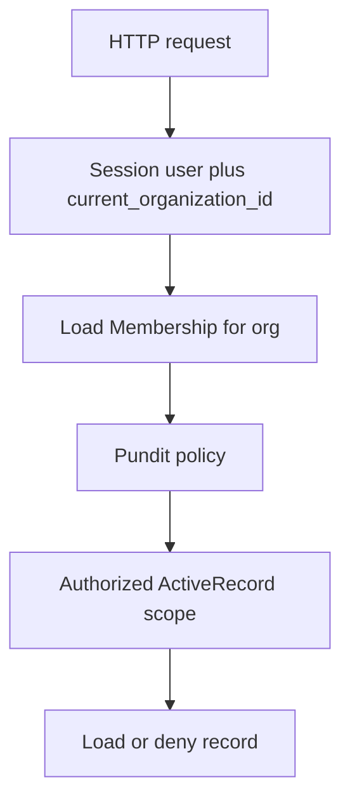
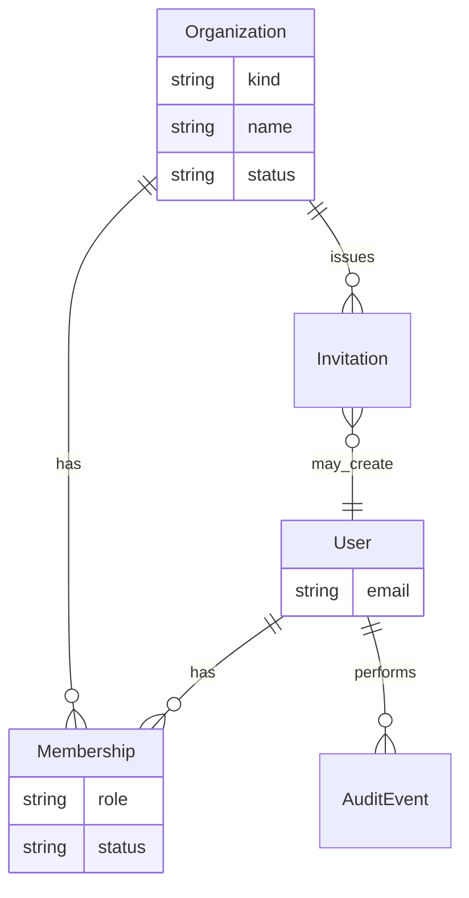
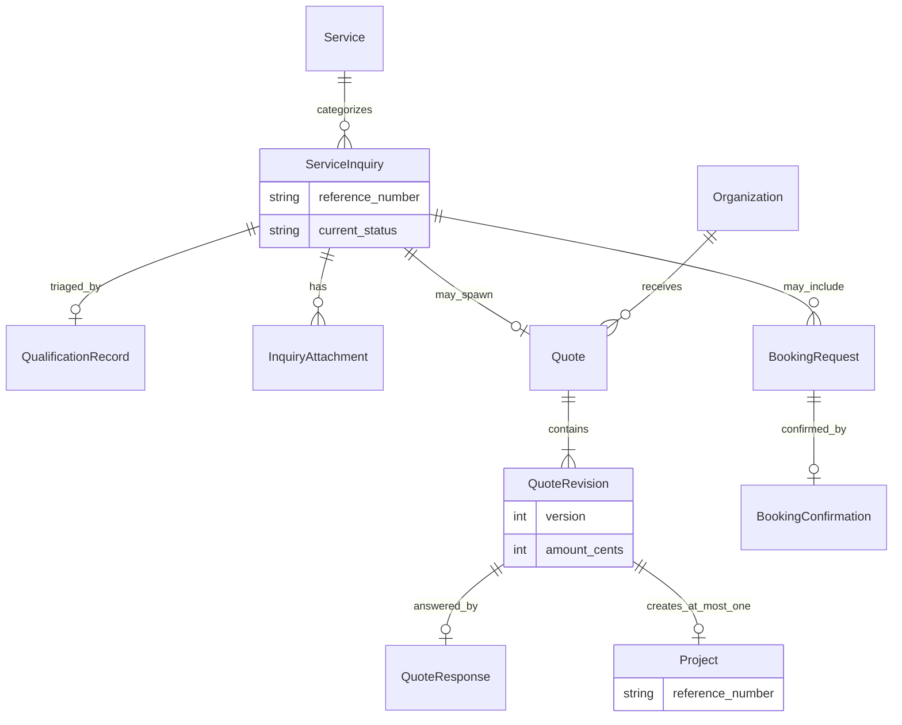
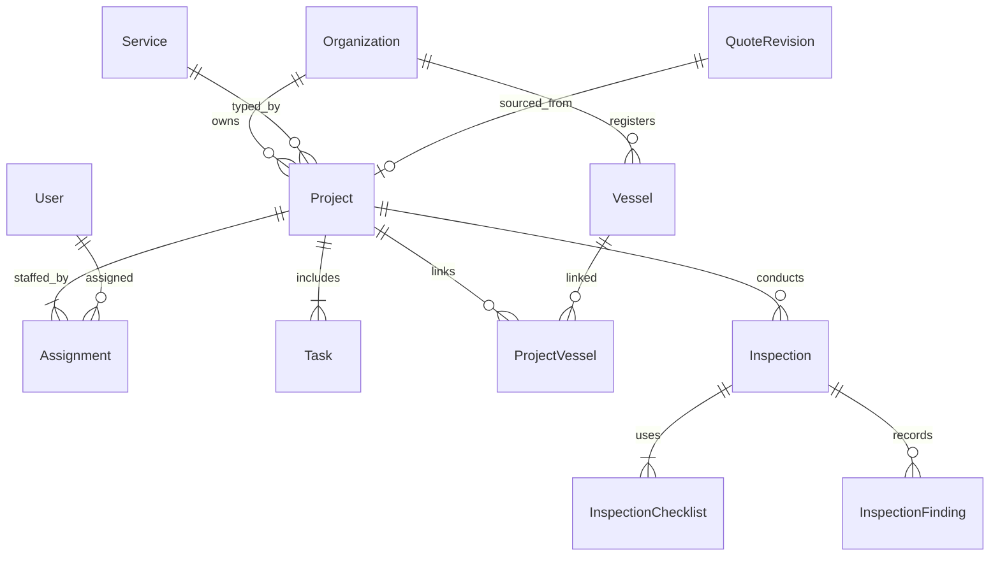
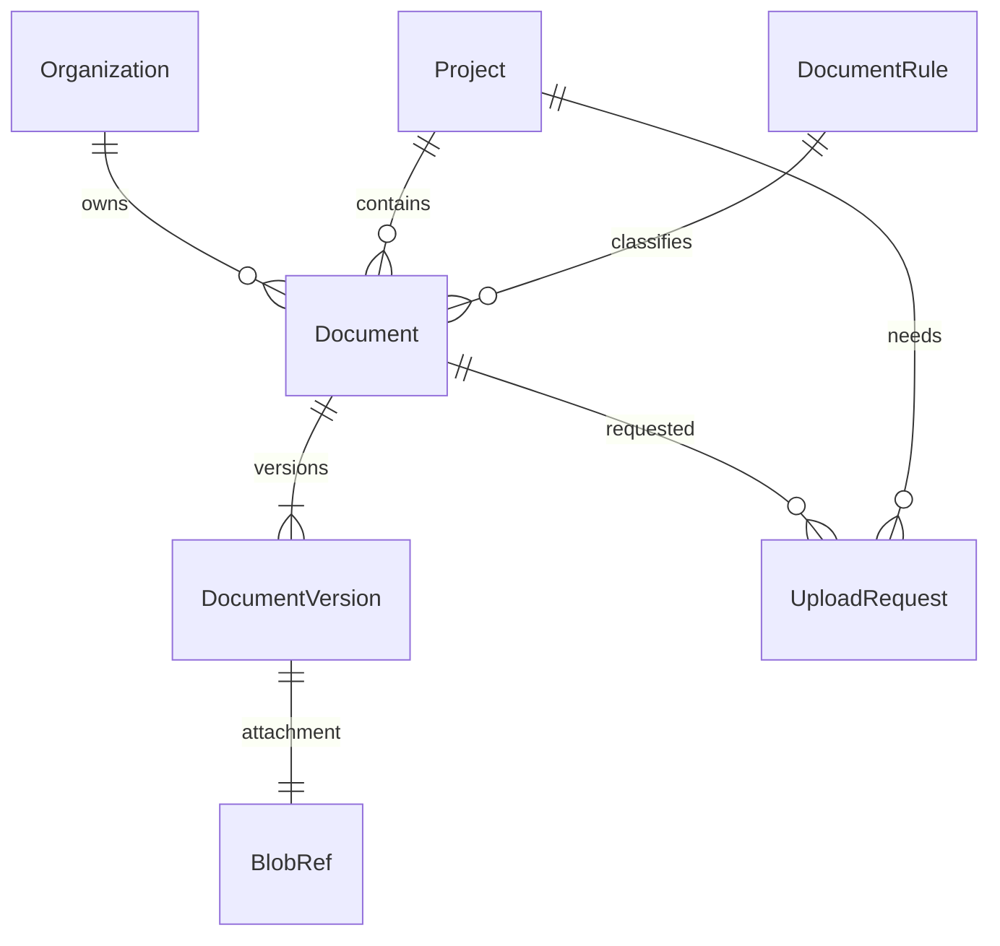
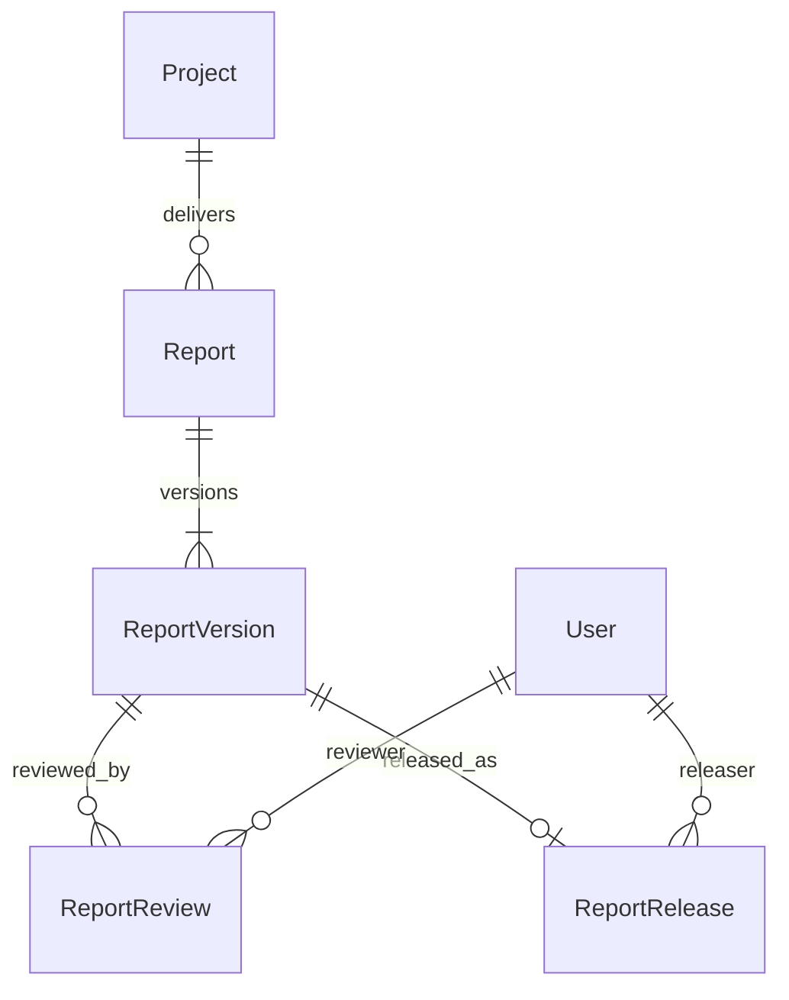
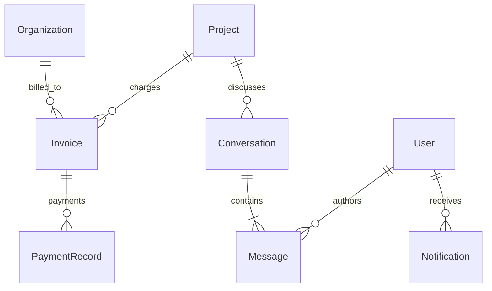
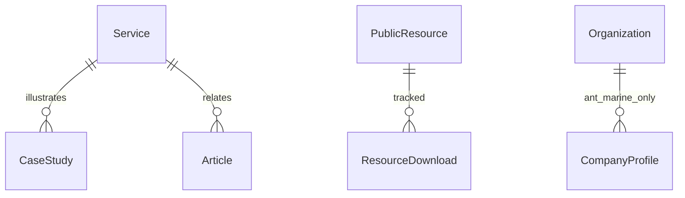

# P2.1 — Domain Relationships & Multi-Organisation Model

**Status:** Awaiting review  
**Companion:** [`P2_1_DOMAIN_ARCHITECTURE.md`](P2_1_DOMAIN_ARCHITECTURE.md)

This document defines cardinalities, ownership, uniqueness, archival rules, and the Rails authorization pattern. No database schema is committed here — names are logical entities for P2.2.

---

## 1. Multi-organisation strategy

### 1.1 Tenancy model

| Rule | Description |
|---|---|
| Client isolation | Every client-facing AR carries `client_organization_id` (or derives it through `Project`) |
| Staff home org | Staff `Membership` rows attach to `Organization` where `kind = ant_marine` |
| Cross-tenant staff access | Staff `ant_marine` membership + feature permission + (`projects.view_all` / related `*_view_all` **or** `Assignment` **or** `DocumentAccessGrant`); see ROLE_PERMISSION_SPEC §5 |
| Public data | CMS entities have no client org; published content is global |
| Pre-tenant inquiries | `ServiceInquiry.client_organization_id` NULL until qualification links/creates client org |

### 1.2 Request authorization flow (Rails)

**Implementation notes (P2.2+):**

- `ApplicationController` sets `Current.user`, `Current.organization`, `Current.membership` per request.
- Never trust `organization_id` from client params alone — verify membership.
- File downloads: authorize `Document` / `ReportRelease` first; generate short-lived storage URL after policy pass.
- List endpoints always use `policy_scope(Model)` — no unscoped `Model.all` in client/staff areas.

### 1.3 Multi-membership users (A06)

| Scenario | Handling |
|---|---|
| User in one client org | Auto-select org after sign-in |
| User in multiple client orgs | Workspace picker; store `session[:organization_id]` |
| Staff who is also a client contact | Separate memberships on different orgs; never merge data |
| Invitation | Always targets one `organization_id` + role |

---

## 2. Organisation and identity

| Relationship | Cardinality | Optional | Notes |
|---|---|---|---|
| Organization → Membership | 1:N | — | At least one admin membership per client org before go-live |
| User → Membership | 1:N | — | Unique index on `(user_id, organization_id)` where active |
| Organization → Invitation | 1:N | yes | Pending invites |
| User → AuditEvent | 1:N | — | Actor for staff/client actions |

**Uniqueness:** `organizations.slug` unique. One canonical `ant_marine` org enforced by app validation (partial unique index on `kind` optional).

**Deletion:** Organizations `archived`, not deleted, if projects exist.

---

## 3. Commercial funnel

| Relationship | Cardinality | Ownership | Lifecycle |
|---|---|---|---|
| Service → ServiceInquiry | 1:N | Inquiry global until org linked | Inquiry statuses in architecture doc |
| ServiceInquiry → Quote | 1:0..1 | Quote owned by client org | Quote may exist without inquiry if staff-created |
| Quote → QuoteRevision | 1:N | Revisions immutable | Monotonic `version` |
| QuoteRevision → QuoteResponse | 1:0..1 | Client action | Accept triggers project guard |
| QuoteRevision → Project | 1:0..1 | Client org | **Unique** `quote_revision_id` on projects |
| ServiceInquiry → BookingRequest | 1:N | — | P23 may duplicate preferred date on inquiry VO |

**Idempotency:** `QuoteResponse` unique on `(quote_revision_id, responded_at)` or accept `idempotency_key` from form.

---

## 4. Project delivery

| Relationship | Cardinality | Notes |
|---|---|---|
| Organization (client) → Project | 1:N | Required FK |
| Project → Assignment | 1:N | Staff user + role on project |
| Project → Vessel | N:M via `ProjectVessel` | Optional MVP |
| Organization → Vessel | 1:N | Vessels never shared across client orgs |
| Project → Inspection | 1:N | Multiple site visits per project |
| Assignment uniqueness | — | Unique `(project_id, user_id, role)` or single lead per role |

**Staff visibility (tiered):**

1. **Org-wide** — roles with `projects.view_all` (coordinator, operations manager, super administrator) see active client projects per policy scope.
2. **Assignment-based** — surveyor, general staff, finance (default), technical reviewer see projects where `assignments.user_id = self`.
3. **Explicit grant** — `DocumentAccessGrant` or assignment kind `technical_reviewer` / `collaborator` for narrow access without org-wide list rights.

**Deletion:** Projects `archived`; assignments kept for audit.

---

## 5. Documents and storage

`BlobRef` represents Active Storage attachment on `DocumentVersion` (not a business AR).

| Relationship | Cardinality | Access rule |
|---|---|---|
| Project → Document | 1:N | Client org must match project org |
| Document → DocumentVersion | 1:N | Latest pointer + immutable history |
| DocumentVersion → blob | 1:1 | No direct public URL |
| UploadRequest → Document | 1:N | Client upload fulfills request |

**Cross-org rule:** `document.client_organization_id` must equal `project.client_organization_id` when both set.

**Uniqueness:** `(document_id, version_number)` unique.

**Archival:** `Document.archived_at`; versions never deleted if released to client.

---

## 6. Reports (review and release)

| Relationship | Cardinality | Rule |
|---|---|---|
| Project → Report | 1:N | Multiple report types per project allowed |
| Report → ReportVersion | 1:N | Draft iterations |
| ReportVersion → ReportReview | 1:N | Re-review after changes |
| ReportVersion → ReportRelease | 1:0..1 | **At most one active release per version** |
| Client visibility | — | Join `ReportRelease` where `client_organization_id` matches session |

**Critical invariant:** `ReportRelease.report_version_id` must reference a version with `ReportReview.decision = approved`.

Reports may optionally link to a `Document` aggregate for shared preview/download machinery — decide in P2.2 (see open decisions).

---

## 7. Billing and collaboration

| Relationship | Cardinality | Access |
|---|---|---|
| Project → Invoice | 1:N | Finance + client managers |
| Invoice → PaymentRecord | 1:N | Finance records only |
| Project → Conversation | 1:1 or 1:N | Proposal: one primary thread per project |
| User → Notification | 1:N | User-private inbox |

---

## 8. Public content (no client org)

CMS entities (`Article`, `CaseStudy`, `TrainingOffering`, `ContentPage`) relate to `Service` optionally via join or tag; they do **not** belong to client organizations.

Published content references approved `CaseStudy` → may link to anonymized `Project` id internally (staff only).

---

## 9. Uniqueness and reference numbers

| Entity | Unique constraint (proposed) |
|---|---|
| ServiceInquiry | `reference_number` global |
| Quote | `reference_number` global |
| Project | `reference_number` global |
| QuoteRevision | `(quote_id, version)` |
| Project | `quote_revision_id` when present |
| Membership | `(user_id, organization_id)` active |
| ReportRelease | `(report_version_id)` for active release |

Reference number format: prefix + year + sequence (generated in DB transaction).

---

## 10. Deletion and archival policies

| Entity | Policy |
|---|---|
| ServiceInquiry | Retain for analytics; archive unqualified |
| Quote / revisions | Never delete sent/accepted revisions |
| Project | `archived` status; retain documents/reports |
| Document versions | No hard delete after client release |
| Report versions | Same as documents |
| User | Deactivate; retain audit attribution |
| Organization | Archive; block if active projects |
| CMS content | Unpublish; retain draft history |

Hard delete only for obvious mistakes **before** client visibility and only with admin audit — exact policy in P2-OD-010.

---

## 11. Indexing hints (P2.2)

Non-exhaustive:

- `projects(client_organization_id, current_status)`
- `assignments(user_id, project_id)`
- `documents(project_id, workflow_status)`
- `service_inquiries(current_status, created_at)`
- `audit_events(auditable_type, auditable_id, occurred_at)`

---

## 12. Relationship to screens

| Screen area | Primary graph |
|---|---|
| P19–P22 | §3 Commercial |
| C05–C12 | §4 + §5 + §6 |
| S01–S06 | §3 |
| S07–S14 | §4 + §6 |
| M09 | DocumentRule → §5 |
| A02–A06 | §2 |