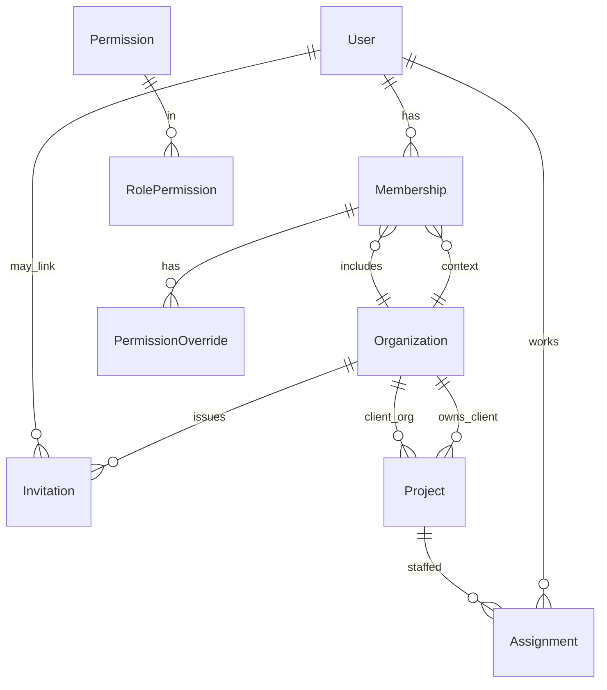

# P2.2 — Database Design Handoff (for P2.3)

**Status:** Phase 2 — **candidates only**; no migrations in P2.2  
**Version:** 1.0 — 22 November 2026  
**Purpose:** Entity inventory and relationships for migration planning  
**Domain detail:** [`P2_1_DOMAIN_ARCHITECTURE.md`](P2_1_DOMAIN_ARCHITECTURE.md), [`P2_1_DOMAIN_RELATIONSHIPS.md`](P2_1_DOMAIN_RELATIONSHIPS.md)

---

## 1. AuthN / AuthZ core (P2.3 priority slice)

| Candidate entity | Class | Key relationships | Notes |
|---|---|---|---|
| `users` | AR | has many `memberships`, `sessions` (if DB-backed) | email unique; `security_version`, `permission_epoch` optional |
| `organizations` | AR | has many `memberships`; `kind` enum | Single row `ant_marine` staff org |
| `memberships` | AR | `user_id`, `organization_id`, `role_key`, `status` | unique `(user_id, organization_id)`; `permission_epoch` |
| `invitations` | AR | `organization_id`, `email`, `role_key`, token, `expires_at`, `invited_by_membership_id` | pending → accepted |
| `sessions` | AR or cookie | `user_id`, `session_version` | optional if DB session store |

| Candidate entity | Class | Key relationships | Notes |
|---|---|---|---|
| `permissions` | AR | seeded catalogue | stable `key`, domain, override rule |
| `role_permissions` | ENT | `role_key`, `permission_key` | join; no custom roles v1 (ADR-016 proposed) |
| `permission_overrides` | ENT | `membership_id`, `permission_key`, `effect` | allow/deny |
| `permission_change_events` | ENT / audit | actor, target, org, diff | or STI under `audit_events` |
| `audit_events` | AR | polymorphic optional | business + security |

---

## 2. Resource scope (links to authorization)

| Candidate entity | Class | Key relationships | Notes |
|---|---|---|---|
| `assignments` | ENT | `project_id`, `user_id`, `assignment_kind`, **`access_scope`** | unique per kind rules |
| `document_access_grants` | ENT | `document_id` or `project_id`, `user_id`, scope | narrow grants |
| `project_participants` | ENT | optional future client tighten | |

Billing (refinement A):

| Candidate entity | Class | Key relationships | Notes |
|---|---|---|---|
| `invoices` | AR | `organization_id`, optional `project_id` | finance via `billing.view_all` on org |

---

## 3. ER diagram (authz subset)

---

## 4. Index and constraint recommendations

| Table | Constraint |
|---|---|
| `memberships` | UNIQUE `(user_id, organization_id)` |
| `users` | UNIQUE `email` (normalized) |
| `invitations` | UNIQUE `token` where pending |
| `permission_overrides` | UNIQUE `(membership_id, permission_key)` |
| `assignments` | INDEX `(user_id, project_id)`; UNIQUE policy per product rule |

---

## 5. Migration sequencing (proposed P2.3)

1. `organizations`, `users` (auth generator may create users)  
2. `memberships`, `invitations`  
3. `permissions`, `role_permissions`, `permission_overrides`  
4. `audit_events` / permission change STI  
5. Business tables (`projects`, `assignments`, …) in later P2.3 slices — **after** authz foundation approved  

---

## 6. Seeds

- ANT Marine staff organisation row  
- Full permission catalogue from `PERMISSION_CATALOGUE.md`  
- Role permissions from `DEFAULT_ROLE_MATRIX.md` (post P2.2 finance/confidential refinements)

---

## 7. Open design questions for P2.3

| ID | Question |
|---|---|
| P2-OD-040 | DB-backed sessions vs encrypted cookie-only |
| P2-OD-041 | Single `audit_events` STI vs separate `permission_change_events` |
| P2-OD-042 | `access_scope` on `assignments` as string enum vs join table |

**Superseded by P2.3:** [`P2_3_DATABASE_ARCHITECTURE.md`](P2_3_DATABASE_ARCHITECTURE.md) and companions. P2-OD-040–042 answered as PROPOSED in [`P2_1_OPEN_DECISIONS.md`](P2_1_OPEN_DECISIONS.md) §7.