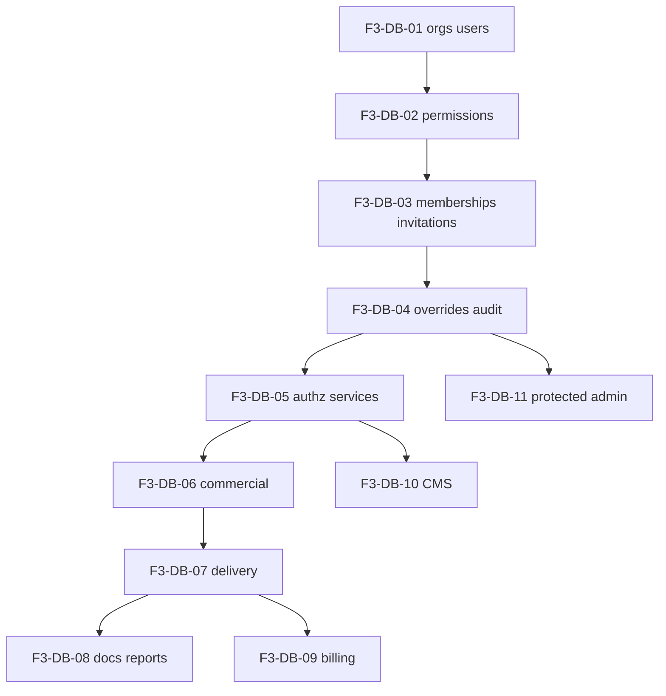

# P2.3 — Phase 3 Migration Plan

**Status:** Design only — **do not run migrations in P2.3**  
**Version:** 1.0 — 22 November 2026  
**Target:** PostgreSQL 17 via existing `config/database.yml`

Each slice: migrations + models + DB constraints + authorization tests + seeds (where noted).

---

## Slice F3-DB-01 — Organizations & users

| Item | Detail |
|---|---|
| Migrations | `organizations`, `users` (+ Rails auth generator columns) |
| Constraints | UNIQUE `organizations.slug`; partial UNIQUE single `ant_marine` org |
| Validations | Org kind enum; email format |
| Seeds | Bootstrap `ant_marine` org |
| Auth tests | N/A |
| Backfill | None |
| Rollback | Drop tables in reverse |
| Acceptance | `db:prepare` succeeds; one staff org row |

---

## Slice F3-DB-02 — Permission catalogue

| Item | Detail |
|---|---|
| Migrations | `permissions`, `role_permissions`, `app_settings` |
| Constraints | UNIQUE `permissions.key` |
| Seeds | Idempotent `db/seeds/permissions.rb` from catalogue v1; `role_permissions` from matrix **without touching overrides** |
| Tests | Seed idempotency twice; key count = 71 |
| Acceptance | All matrix keys resolvable |

---

## Slice F3-DB-03 — Memberships & invitations

| Item | Detail |
|---|---|
| Migrations | `memberships`, `invitations` |
| Constraints | UNIQUE `(user_id, organization_id)`; partial UNIQUE pending token |
| Tests | Cross-domain role_key rejection; invite accept race (two accepts → one wins) |
| Policies | Stub membership scope |
| Acceptance | T-07, T-08 threat scenarios |

---

## Slice F3-DB-04 — Overrides & audit

| Item | Detail |
|---|---|
| Migrations | `permission_overrides`, `audit_events` (STI) |
| Constraints | UNIQUE override per membership+permission |
| Tests | T-06 epoch; T-19 delegation; permission change audit row |
| Acceptance | Override deny beats role grant |

---

## Slice F3-DB-05 — Authorization foundation

| Item | Detail |
|---|---|
| Code slice | EffectivePermissions, PermissionGranter, Pundit base (ADR-012 proposed) |
| Migrations | None if catalogue complete |
| Tests | Full layer 1–6 unit tests; cross-org denial |
| Acceptance | Phase 3 exit partial gate |

---

## Slice F3-DB-06 — Commercial core

| Migrations | `services`, `service_inquiries`, `quotes`, `quote_revisions`, `quote_responses`, `booking_*` |
| Constraints | UNIQUE inquiry ref; UNIQUE quote_revision version; immutable revision (no update trigger) |
| Tests | Anonymous inquiry null org; accept stores membership |
| Acceptance | P19–P22 data path |

---

## Slice F3-DB-07 — Projects & assignments

| Migrations | `projects`, `assignments`, `vessels`, `project_vessels`, `tasks`, `inspections`, `project_status_events` |
| Constraints | UNIQUE `projects.quote_revision_id`; `access_scope` CHECK |
| Tests | T-02 assignment scope; reviewer `review` scope |
| Acceptance | Tiered staff visibility queries |

---

## Slice F3-DB-08 — Documents & reports

| Migrations | `documents`, `document_versions`, `document_access_grants`, `upload_requests`, `reports`, `report_versions`, `report_reviews`, `report_releases` |
| Constraints | Immutable versions; release FK to version |
| Tests | T-11 confidential; T-13 release without approve denied |
| Acceptance | Client sees report only via release row |

---

## Slice F3-DB-09 — Billing & collaboration

| Migrations | `invoices`, `invoice_lines`, `payment_records`, `conversations`, `messages`, `notifications` |
| Constraints | Invoice ref unique |
| Tests | T-15 finance without assignment |
| Acceptance | `billing.view_all` lists by `client_organization_id` |

---

## Slice F3-DB-10 — Public CMS & rules

| Migrations | `articles`, `case_studies`, `training_offerings`, `public_resources`, `resource_downloads`, `document_rules` |
| Tests | Published scope public read |
| Acceptance | No client confidential in public tables |

---

## Slice F3-DB-11 — Protected administration

| Item | Detail |
|---|---|
| Focus | Services + DB transactions for owner/super-admin succession |
| Migrations | Optional `membership_protection_locks` — **not recommended**; use advisory locks |
| Tests | T-09, T-20 concurrent last-owner attempts |
| Acceptance | Exactly one owner invariant under concurrency |

---

## Dependency graph

---

## Rollback strategy

- One migration per concern where practical; `down` methods required for foundation slices 01–04.
- Business slices 06–10 may use irreversible migrations only after stakeholder approval.
- Production: backup before slice; never truncate `audit_events` or `permission_overrides` in seeds.

---

## P2.4 handoff

P2.4 (workflow/state machine detail) builds on tables defined here without renaming FK columns.