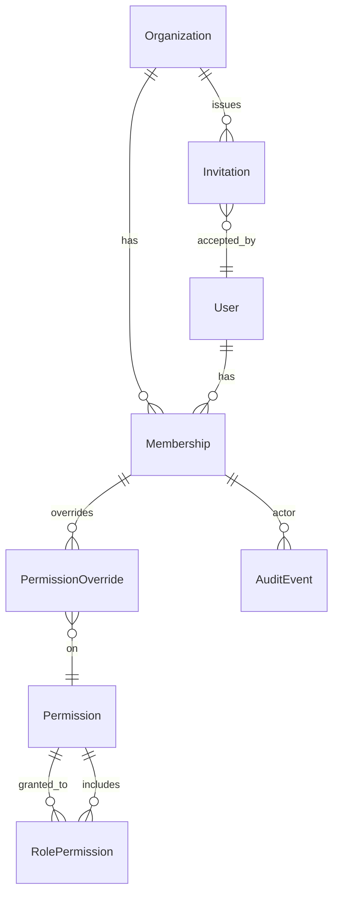
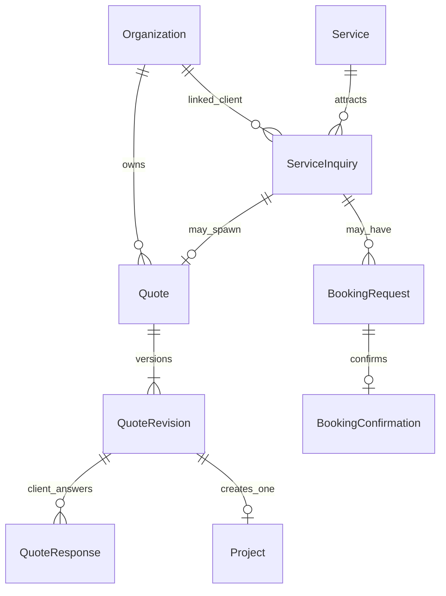
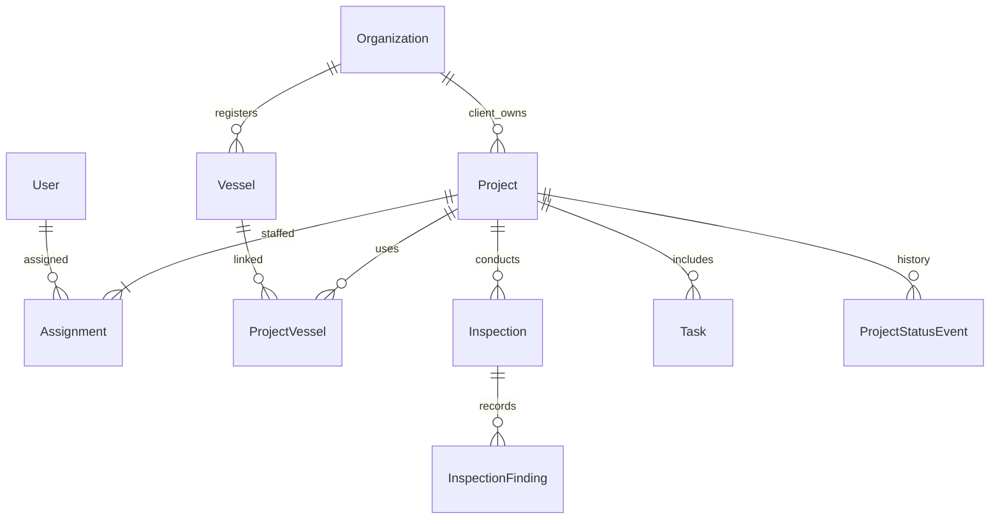
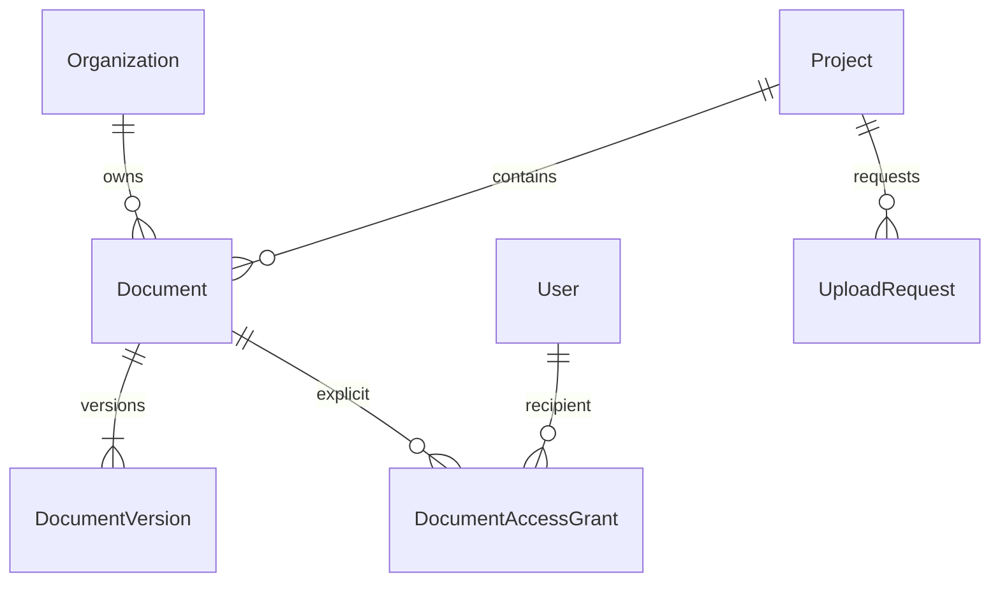
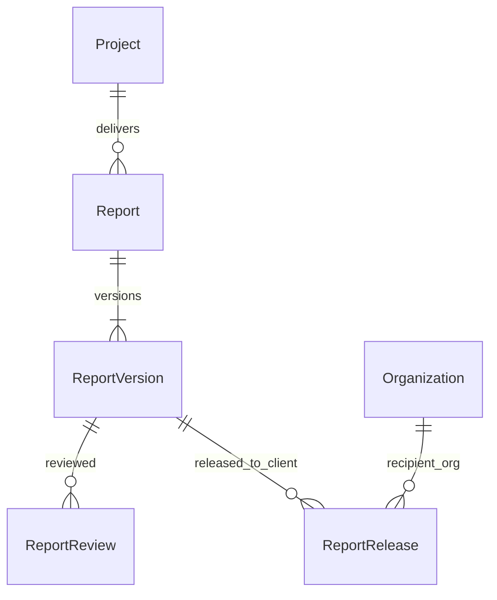
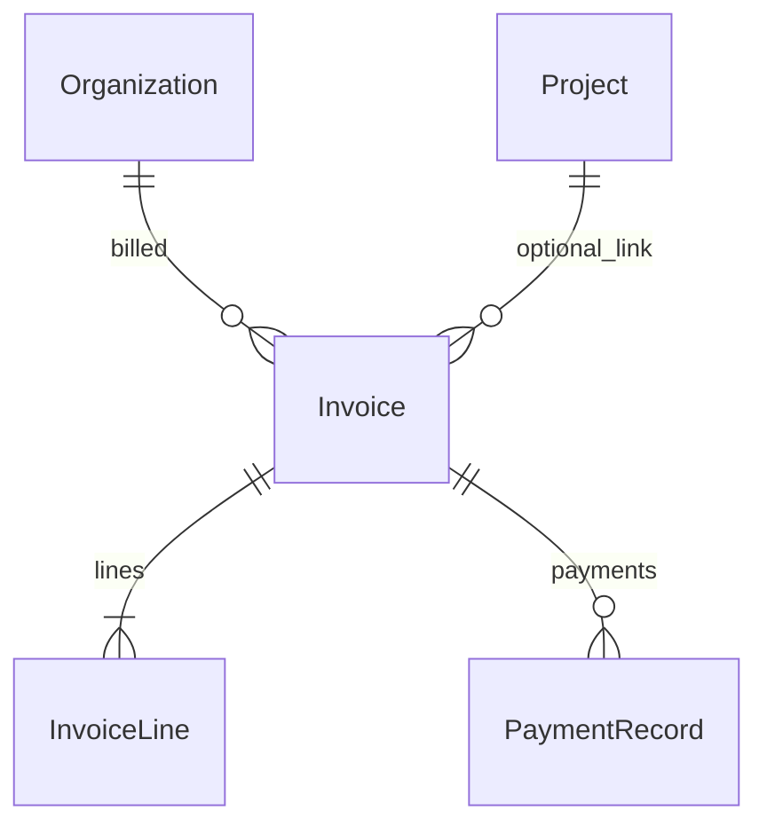
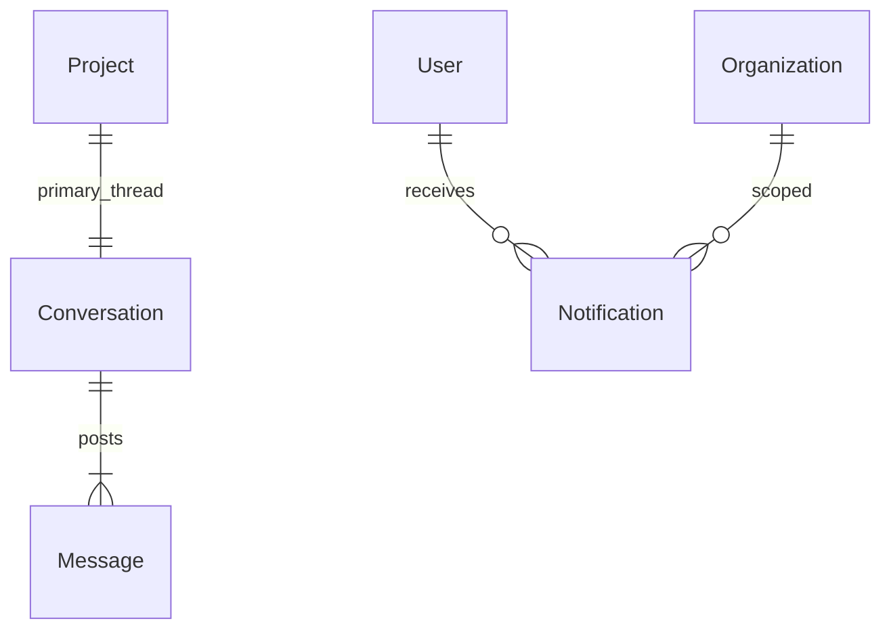
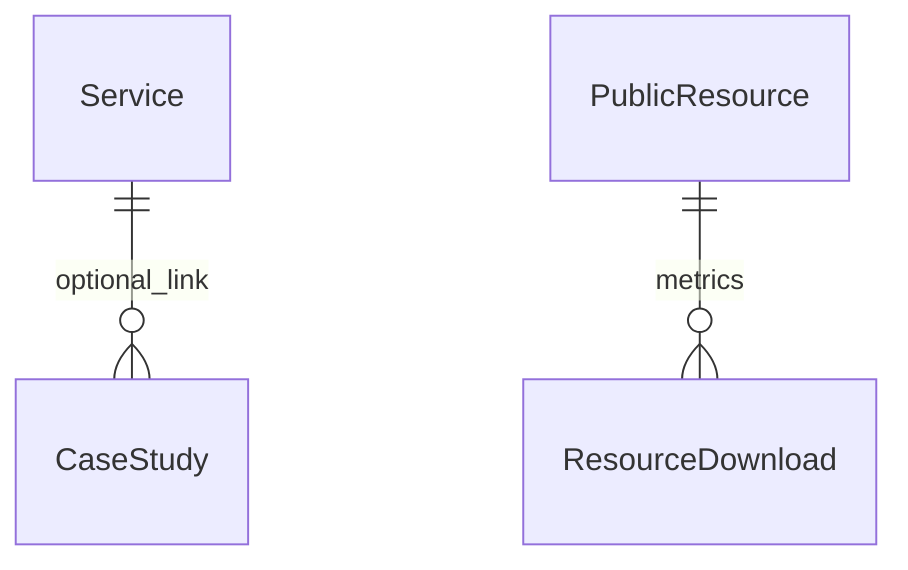
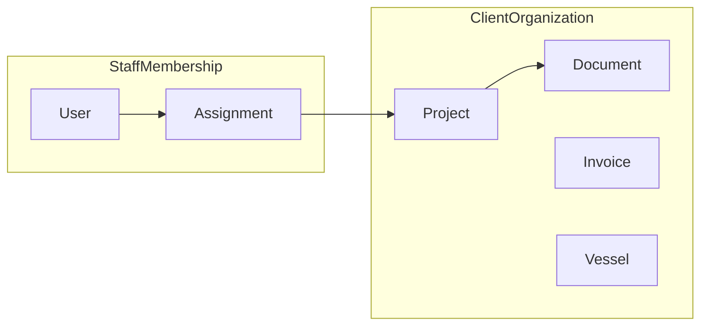

# P2.3 — Relationship Diagrams

**Version:** 1.0 — 22 November 2026  
**Notation:** `||--o{` one-to-many; cardinalities match [`P2_1_DOMAIN_RELATIONSHIPS.md`](P2_1_DOMAIN_RELATIONSHIPS.md) unless noted.

---

## Platform — identity & RBAC

---

## Commercial funnel

---

## Delivery

---

## Documents

---

## Reports

---

## Billing

---

## Collaboration

---

## Public CMS (simplified)

---

## Cross-context tenancy (logical)

Staff **never** store `client_organization_id` on `users`; access paths traverse `assignments` or policy-scoped queries.