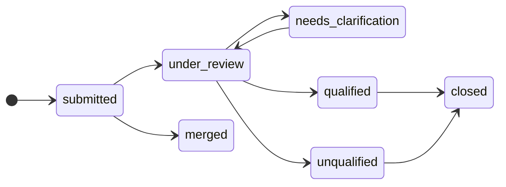
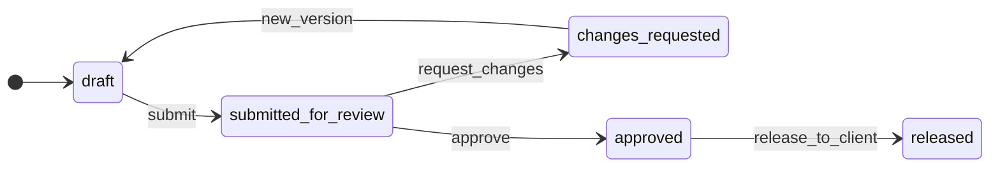

# P2.4 — State Transitions

**Version:** 1.0 — 22 November 2026  
**Contract:** Each row is one allowed transition. Stable `transition_key` for services and audit.

Legend: **Perm** = feature permission; **Scope** = resource path (§ ROLE_PERMISSION_SPEC §5).

---

## Service inquiry

| From | To | transition_key | Actor | Perm | Scope | Preconditions | Audit | Notify |
|---|---|---|---|---|---|---|---|---|
| — | submitted | submit | public / client | — / `inquiries.create` | — | Valid form | create | staff queue |
| submitted | under_review | assign_reviewer | staff | `inquiries.qualify` | staff | Owner user set | status | assignee |
| under_review | needs_clarification | request_clarification | staff | `inquiries.qualify` | staff | | status | contact |
| * | qualified | mark_qualified | staff | `inquiries.qualify` | staff | Org linked or created | status | client invite? |
| * | unqualified | mark_unqualified | staff | `inquiries.qualify` | staff | Reason required | status | contact |
| * | merged | merge_duplicate | staff | `inquiries.qualify` | staff | Target inquiry id | status | — |
| * | closed | close | staff | `inquiries.qualify` | staff | | status | — |

---

## Quote (aggregate)

| From | To | transition_key | Actor | Perm | Preconditions |
|---|---|---|---|---|---|
| — | draft | create | staff | `quotes.create` | Inquiry optional |
| draft | draft | add_revision | staff | `quotes.create` | New immutable revision row |
| draft | sent | send | staff | `quotes.send` | One revision marked sent |
| sent | accepted | accept | client | `quotes.accept` | Valid sent revision |
| sent | declined | decline | client | `quotes.decline` | |
| sent | withdrawn | withdraw | staff | `quotes.withdraw` | |
| sent | expired | expire | system | — | `valid_until` < today |
| accepted | — | — | — | — | Terminal for quote parent |

Superseding: staff creates **new revision** while `draft`; prior `sent` withdrawn before new send.

---

## Project

| From | To | transition_key | Actor | Perm | Scope | Idempotency |
|---|---|---|---|---|---|---|
| — | planning | create_from_quote | staff | `projects.create` | quote org | UNIQUE quote_revision_id |
| planning | site_work | start_site_work | staff | `projects.manage` | view_all / assign | |
| site_work | review | enter_review | staff | `projects.manage` | assign | |
| review | report_ready | mark_report_ready | staff | `projects.manage` | assign | |
| report_ready | closed | close | staff | `projects.manage` | assign | |
| closed | archived | archive | staff | `projects.manage` | view_all | |
| * | suspended | suspend | staff | `projects.manage` | view_all | reason |
| suspended | planning | reopen | staff | `projects.manage` | view_all | audit |

Client sees mapped `client_status` only (C05).

---

## Assignment

| From | To | transition_key | Actor | Perm | Scope |
|---|---|---|---|---|---|
| — | active | assign | staff | `projects.assign` | project |
| active | inactive | unassign | staff | `projects.assign` | project |
| — | active | reassign | staff | `projects.assign` | deactivate + insert |

`access_scope` set at assign: `delivery`, `review`, `collaborator` (P2-OD-042 proposed).

---

## Document scan_status

| From | To | Actor | Notes |
|---|---|---|---|
| — | pending_upload | user | Record created |
| pending_upload | scanning | system job | Blob attached |
| scanning | available | scan pass | Download allowed if policy OK |
| scanning | rejected | scan fail | No download |

---

## Report version

| From | To | transition_key | Actor | Perm | Scope | SoD |
|---|---|---|---|---|---|---|
| — | draft | create_version | staff | `reports.draft` | assignment delivery | |
| draft | submitted_for_review | submit | staff | `reports.draft` | assignment | |
| submitted_for_review | changes_requested | request_changes | staff | `reports.review` | assignment review | not author |
| submitted_for_review | approved | approve | staff | `reports.approve` | assignment review | not author |
| changes_requested | draft | new_version | staff | `reports.draft` | assignment | new version row |

**Release (separate aggregate):**

| From | To | transition_key | Actor | Perm | Preconditions |
|---|---|---|---|---|---|
| — | released | release_to_client | staff | `reports.release` | `report_reviews.decision = approved` on version |

Client visibility: `report_releases` row only.

---

## Invoice

| From | To | transition_key | Actor | Perm | Scope |
|---|---|---|---|---|---|
| — | draft | create | staff | `billing.manage` | billing.view_all / project |
| draft | issued | issue | staff | `billing.manage` | org |
| issued | partially_paid | record_payment | staff | `billing.record_payment` | org |
| * | paid | record_payment | staff | `billing.record_payment` | full amount |
| issued | overdue | mark_overdue | system | — | due date |
| * | voided | void | staff | `billing.adjust` | reason + step-up |

---

## Membership

| From | To | transition_key | Actor | Perm | Guards |
|---|---|---|---|---|---|
| — | invited | invite | admin | `team.invite` | role ceiling |
| invited | active | accept_invitation | user | — | valid token |
| active | suspended | suspend | admin | `team.suspend` | |
| suspended | active | reactivate | admin | `team.suspend` | |
| active | removed | remove | admin | `team.suspend` | last owner / super admin |

---

## Permission override (logical)

| Action | transition_key | Actor | Perm | Effects |
|---|---|---|---|---|
| Set allow | grant_override | admin | manage permissions | epoch++ |
| Set deny | deny_override | admin | manage permissions | epoch++ |
| Clear | restore_inherit | admin / self | manage or restore | delete override row |

---

## User-facing labels

Map internal `current_status` to handoff copy (e.g. `site_work` → “Site work” on C05). Store mapping in I18n YAML per Phase 4.