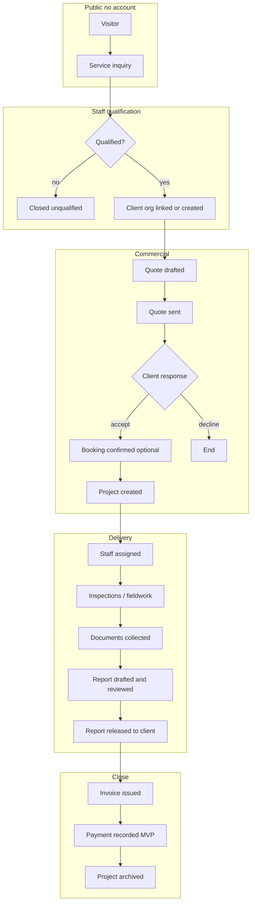

# P2.4 — Workflow Architecture

**Status:** Phase 2 design — documentation only  
**Version:** 1.0 — 22 November 2026  
**Sources:** Master spec §2, P2.1 domain, P2.2 authz, P2.3 schema, Phase 1 handoff

**Companion docs:**

| Document | Focus |
|---|---|
| [`P2_4_STATE_TRANSITIONS.md`](P2_4_STATE_TRANSITIONS.md) | State tables & diagrams |
| [`P2_4_AUTHORIZATION_WORKFLOW_MATRIX.md`](P2_4_AUTHORIZATION_WORKFLOW_MATRIX.md) | Permissions per transition |
| [`P2_4_EVENTS_AND_CONCURRENCY.md`](P2_4_EVENTS_AND_CONCURRENCY.md) | Notifications & idempotency |
| [`P2_4_OPEN_DECISIONS.md`](P2_4_OPEN_DECISIONS.md) | Unresolved workflow choices |

---

## 1. End-to-end customer journey

Not every engagement uses every step. **Alternative entry points:** logged-in client request (C02), staff-created inquiry (S02), booking-only (P23), follow-on work from closed project (new inquiry/quote).

| Stage | Optional? | Skip when |
|---|---|---|
| Booking confirmation | Yes | Remote-only desk work; date not applicable |
| Multiple inspections | Yes | Single visit sufficient |
| Vessel registry | Yes | P2-OD-024 |
| Live payment | Yes | ADR-008 records-only MVP |

**Public inquiries:** `service_inquiries.channel = public_form`; `client_organization_id` NULL until qualification (ADR-014 proposed).

---

## 2. Service inquiries (Task 2)

| State | User label | Meaning |
|---|---|---|
| `submitted` | Received | Awaiting staff |
| `under_review` | Under review | Assigned coordinator |
| `needs_clarification` | We need more information | Staff requested detail |
| `qualified` | Qualified | May proceed to quote |
| `unqualified` | Not a fit | Closed with reason |
| `merged` | Combined with another request | Duplicate handling |
| `closed` | Closed | Terminal |

**Transitions:** See [`P2_4_STATE_TRANSITIONS.md`](P2_4_STATE_TRANSITIONS.md) § Inquiries.

**Safeguards:** Rate limit public POST; honeypot/CAPTCHA (Phase 3); attachment size per `document_rules`.

**Onboarding:** After `qualified`, staff link/create client org → invitation flow (ADR-005 proposed).

**Duplicates:** Staff `merged` transition; retain both refs in audit metadata.

---

## 3. Quotation workflow (Task 3)

**Quote parent** (`quotes.current_status`): `draft` → `sent` → `accepted` | `declined` | `withdrawn` | `expired`.

**Revisions** (`quote_revisions`): **immutable** after creation; new commercial terms = new revision row.

| Action | Typical permission | Resource scope |
|---|---|---|
| Create draft | `quotes.create` | Staff org-wide |
| Edit draft revision | `quotes.create` | Same quote |
| Internal review | `quotes.create` / ops policy | Optional second staff sign-off — process not separate state in MVP |
| Send | `quotes.send` | Sets `sent_at` on revision; quote → `sent` |
| Client accept | `quotes.accept` | Membership in client org; revision must be current `sent` |
| Client decline | `quotes.decline` | Same |
| Withdraw | `quotes.withdraw` | Staff |
| Expire | System job | `valid_until` passed |

**Binding client:** Only `quotes.accept` on active sent revision; `quote_responses.responded_by_membership_id` stores evidence (ADR-006 proposed).

**Quote → project:** Staff transition `create_project_from_acceptance` after acceptance — **not** automatic on client click alone.

**One revision → multiple projects?** See P2-OD-043 in [`P2_4_OPEN_DECISIONS.md`](P2_4_OPEN_DECISIONS.md). **P2.3 PROPOSED default:** UNIQUE `projects.quote_revision_id` (1:1). Multi-phase delivery via **new quote/change order**, not silent many-to-one.

---

## 4. Booking & projects (Task 4)

| Entity | Key states |
|---|---|
| `booking_requests` | `submitted` → `confirmed` \| `cancelled` \| `superseded` |
| `booking_confirmations` | Created on staff confirm (`bookings.confirm`) |
| `projects.internal_status` | `planning` → `site_work` → `review` → `report_ready` → `closed` → `archived` |
| `projects.client_status` | Simple mapped labels for C05 timeline |

**Project creation guards:** Accepted `quote_response` + staff `projects.create` + idempotency key.

**Assignments:** `assignments` active flag; reassignment = deactivate old + insert new; audit.

**Suspension:** `projects.internal_status = suspended` (proposed) — optional state between active and closed.

**Reopen:** `closed` → `planning` with audit + reason (coordinator).

**Vessels:** `project_vessels` N:M.

---

## 5. Inspections & assignments (Task 5)

Workflow: assign surveyor → (optional accept assignment — UX only, record `accepted_at`) → preparation → fieldwork → checklist complete → findings → coordinator review → corrections → `inspections.status = completed`.

**Authz:** Surveyor requires `Assignment` + `access_scope: delivery` + catalogue keys. Reviewer: `access_scope: review` only. Direct URL denied without assignment (T-05).

---

## 6. Documents (Task 6)

Dual state machines (P2.1 §6.2):

- **scan_status:** `pending_upload` → `scanning` → `available` \| `rejected`
- **workflow_status:** category-dependent; confidential requires `documents.access_confidential`

**Download rule:** `scan_status = available` AND policy pass AND signed URL TTL (5–15 min proposed). **Quarantined/rejected:** never downloadable.

**Versioning:** New upload = new `document_versions` row; supersede pointer on `documents.current_version_id`.

---

## 7. Reports (Task 7)

Roles: **author** (surveyor, `reports.draft`) → **reviewer** (`reports.review`, `reports.approve`) → **releaser** (`reports.release`) — SoD: author ≠ sole approver default.

**Version lifecycle:** `draft` → `submitted_for_review` → `changes_requested` \| `approved` → **release is separate action** creating `report_releases` row.

Unapproved version **cannot** release. Release always references **exact** `report_version_id` that passed review.

**Amendments after release:** New `report_version` + new review + **new** `report_release` (supersedes client visibility via latest release pointer — product rule in Phase 4).

---

## 8. Billing (Task 8)

MVP: **manual payment recording** only (ADR-008 OPEN, default records-only).

Invoice: `draft` → `approved_internal` (optional) → `issued` → `partially_paid` → `paid` \| `overdue` → `voided`.

Finance access via `billing.view_all` — no project assignment (P2.2/P2.3).

No card PAN storage; `payment_records.method` = `bank_transfer`, `cheque`, etc.

---

## 9. Communications (Task 9)

Event catalogue in [`P2_4_EVENTS_AND_CONCURRENCY.md`](P2_4_EVENTS_AND_CONCURRENCY.md). Pattern: **persist `notifications` + enqueue mail after commit** (P2-OD-009 proposed).

---

## 10. Identity & permission workflows (Task 10)

| Flow | Highlights |
|---|---|
| Staff invite | `invitations` → accept → `memberships` staff role |
| Client invite | Owner/delegated admin; role ceiling |
| Permission edit | Override + audit + epoch bump; M07j/C15 step-up |
| Ownership transfer | Dual confirm; last-owner lock |
| Org switch | Session `current_membership_id` |

Client admins never receive staff portal routes (namespace gate + domain separation).

---

## 11. Phase 3/4 handoff

| Phase | Deliverable |
|---|---|
| Phase 3 | Transition service objects, state guards, idempotency keys, audit writes |
| Phase 4 | UI wired to screens in handoff + DCR for permissions |

Implementation pattern: `app/services/transitions/*` + `ActiveRecord::Base.transaction` + `after_commit` jobs.

---

## 12. Design traceability (Task 14 summary)

| Workflow | Primary screens |
|---|---|
| Inquiry | P19–P22, S01–S03 |
| Quote | S04–S05, C03–C04 |
| Project | S07–S11, C05–C08 |
| Report | S12–S14, C11–C12 |
| Invoice | S15, C14 |
| Permissions | DCR M07a–j, C15a–j (awaiting approval) |

**Gaps:** See [`P2_4_OPEN_DECISIONS.md`](P2_4_OPEN_DECISIONS.md) § Design gaps (duplicate inquiry merge UI, quote internal review step, assignment accept, invoice void).